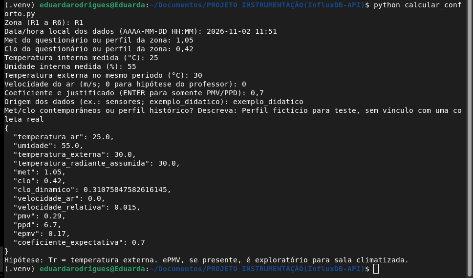

# Grupo 1 — Caracterização de Ocupação e Conforto Térmico

Repositório do **Grupo 1** do projeto de conforto térmico do Laboratório de Arquitetura de Computadores — Bloco 4, **UFC Campus Quixadá**.

## Sobre o projeto

O Grupo 1 realiza a caracterização da ocupação e da percepção térmica dos usuários do laboratório, considerando sua divisão espacial em **seis zonas (R1–R6)** e diferentes períodos de ocupação.

A partir dos questionários, são estimados e organizados:

- **Taxa metabólica (`met`)**, conforme as atividades relatadas;
- **Isolamento térmico das vestimentas (`clo`)**, conforme as roupas utilizadas;
- Perfis de ocupação e distribuição dos respondentes;
- Sensação, satisfação e preferência térmica.

Os perfis de ocupação, `met` e `clo` apoiam a modelagem realizada pelo Grupo 2. O projeto também inclui a persistência de schedules no **InfluxDB** e um script para cálculo de **PMV, PPD e ePMV**.

O cálculo dos índices pode utilizar diretamente as medições ambientais da rede de sensores, sem depender da simulação computacional.

## Estado atual

| Etapa | Situação |
|---|---|
| Divisão espacial em seis zonas | Realizada |
| Aplicação dos questionários | 40 respostas válidas |
| Estimativa de `met` e `clo` | Implementada |
| Scripts de ingestão de schedules no InfluxDB | Disponíveis |
| Cálculo de PMV/PPD e ePMV opcional | Implementado e testado com dados fictícios |
| Gravação dos índices no InfluxDB | Implementada; validação na infraestrutura pendente |
| Avaliação com dados ambientais reais | Pendente |
| Definição justificada do coeficiente de expectativa | Pendente |

## Estrutura

Arquivos e diretórios principais:

```text
.
├── Setup_InfluxDB_Schedules-API/
├── docs/
│   └── imagens/
│       └── exemplo_calculo.png
├── Grupo1_Schedules_met_clo_ASHRAE55.xlsx
├── Relatório.pdf
├── calcular_conforto.py
├── requirements-conforto.txt
├── LEIA-ME.md
├── .gitignore
└── README.md
```

O repositório também contém o guia de implantação e acesso à API.

- `Setup_InfluxDB_Schedules-API/`: infraestrutura e scripts de ingestão dos schedules.
- `calcular_conforto.py`: cálculo dos índices e gravação opcional no InfluxDB.
- `requirements-conforto.txt`: dependências do módulo de cálculo.
- `LEIA-ME.md`: instruções complementares e limitações.
- `docs/imagens/exemplo_calculo.png`: registro do teste com dados fictícios.

## Zonas

O laboratório foi dividido em seis regiões, identificadas como **R1, R2, R3, R4, R5 e R6**.


A base de questionários recebida contém respostas das zonas **R1, R2, R5 e R6**.

A ausência de respostas em R3 e R4 não comprova, por si só, que essas zonas estavam desocupadas.

## Coleta dos questionários

Os questionários foram aplicados entre **28/09/2026 e 01/10/2026**, totalizando **40 respostas válidas**.

Os períodos de referência utilizados na organização inicial são:

- **Manhã — 10h**
- **Tarde 1 — 13h30**
- **Tarde 2 — 15h30**

Os horários de envio das respostas não coincidem necessariamente com esses horários de referência.

### Agrupamento e interpretação dos dados

Na versão inicial dos scripts:

- `ingestao_automatizada.py` agrupa as respostas por zona, data e hora inteira;
- `ingestao_schedules.py` utiliza valores consolidados nos horários de referência, associados a uma data-base.

Essas duas formas de organização precisam ser harmonizadas antes de serem utilizadas como um único conjunto de schedules. Um histórico de coleta e um perfil representativo devem ser identificados separadamente.

No script automático, o campo `ocupacao` corresponde à contagem de respostas do agrupamento. Esse valor só pode ser interpretado como número total de ocupantes se houver evidência de que todas as pessoas presentes responderam ao questionário.

## Schedules e integração entre grupos

Os schedules reúnem informações de ocupação, `met` e `clo`, associadas às zonas e aos períodos analisados.

A integração entre grupos deve utilizar os dados disponibilizados pela API do InfluxDB. A planilha e o relatório permanecem como documentação da etapa de caracterização.

É necessário distinguir:

- **Dados históricos:** associados às datas e aos horários reais da coleta;
- **Perfis representativos:** valores consolidados utilizados para representar condições típicas de ocupação.

## Cálculo dos índices de conforto térmico

O script `calcular_conforto.py` calcula:

- **PMV:** voto médio previsto de sensação térmica;
- **PPD:** percentual previsto de insatisfeitos associado ao PMV;
- **ePMV:** extensão do PMV com fator de expectativa e correção metabólica, calculada quando o coeficiente de expectativa é informado.

O PPD retornado corresponde ao **PMV convencional**, não ao ePMV.

### Entradas necessárias

| Entrada | Unidade ou formato | Origem |
|---|---|---|
| Zona | R1 a R6 | Mapeamento do laboratório |
| Data e horário | `AAAA-MM-DD HH:MM` | Período analisado, no fuso de Fortaleza |
| Taxa metabólica | met | Questionários |
| Isolamento das roupas | clo | Questionários |
| Temperatura interna | °C | Rede de sensores |
| Umidade relativa interna | % | Rede de sensores |
| Temperatura externa | °C | Dado externo correspondente ao período |
| Velocidade ambiente do ar | m/s | Medição ou hipótese identificada |
| Coeficiente de expectativa | Adimensional | Definição metodológica justificada |

O programa também solicita a origem dos dados e a descrição do perfil de `met` e `clo` utilizado.

### Hipóteses e limitações

Para o exercício, foram adotadas as seguintes simplificações:

- **Temperatura radiante média igual à temperatura externa**, conforme a orientação recebida. Essa substituição é uma hipótese do exercício, não uma medição da temperatura radiante.
- **Velocidade ambiente inicialmente igual a zero**, como hipótese de cálculo. O fluxo dos aparelhos de ar-condicionado pode alterar a velocidade junto aos ocupantes e deve ser avaliado.

A biblioteca realiza os ajustes de velocidade relativa e isolamento dinâmico. Assim, esses valores podem diferir da velocidade ambiente e do `clo` informados.

O ePMV utilizado foi desenvolvido para ambientes não climatizados em climas quentes. Sua aplicação à sala com ar-condicionado é tratada como **exploratória**, devendo ser justificada na metodologia.

O coeficiente de expectativa não deve ser escolhido apenas para produzir um resultado desejado.

### Correspondência temporal

As medições ambientais devem corresponder à zona e ao período que se pretende avaliar.

Se os valores históricos de `met` e `clo` forem utilizados com medições de outro período, o resultado deve ser identificado como avaliação de um **perfil representativo**, e não como reconstrução das condições da coleta original.

Quando utilizados `met` e `clo` médios, o resultado caracteriza esse perfil médio; ele não equivale necessariamente à média dos índices calculados individualmente para os respondentes.

## Instalação e execução

Os comandos abaixo devem ser executados na raiz do repositório, em um terminal Linux.

### 1. Criar e ativar o ambiente virtual

```bash
python3 -m venv .venv
source .venv/bin/activate
```

### 2. Instalar as dependências

```bash
python -m pip install -r requirements-conforto.txt
```

### 3. Executar sem gravar no banco

```bash
python calcular_conforto.py
```

Preencha os campos solicitados.

Nos campos numéricos, informe somente o número, sem unidade. Por exemplo:

```text
Temperatura interna medida (°C): 25
```

O programa aceita ponto ou vírgula como separador decimal.

Para calcular somente PMV e PPD, pressione **Enter** no campo do coeficiente de expectativa.

## Exemplo de funcionamento

Foi realizado um teste com os seguintes **valores fictícios**:

| Entrada | Valor |
|---|---:|
| Met | 1,05 |
| Clo | 0,42 |
| Temperatura interna | 25 °C |
| Umidade relativa | 55% |
| Temperatura externa assumida como radiante | 30 °C |
| Velocidade ambiente | 0 m/s |
| Coeficiente de expectativa | 0,7 |

Resultados obtidos com `pythermalcomfort==4.6.2`:

| Índice | Resultado |
|---|---:|
| PMV | 0,29 |
| PPD | 6,7% |
| ePMV | 0,17 |



**Esses resultados demonstram a execução do programa e não representam medições ou conclusões sobre o conforto real do laboratório.**

O coeficiente `0,7` foi utilizado somente para o teste.

## Gravação dos índices no InfluxDB

A gravação é opcional e utiliza a API nativa do InfluxDB.

Os resultados são armazenados no measurement **`conforto_calculado`**, separado dos schedules existentes em **`schedules_r1_r6`**.

São registrados:

- Zona e timestamp Unix em milissegundos;
- Entradas utilizadas no cálculo;
- Valores ajustados pela biblioteca;
- PMV e PPD;
- ePMV e coeficiente de expectativa, quando informados;
- Origem dos dados e descrição do perfil;
- Identificação das hipóteses e dos cenários.

### Configuração da conexão

```bash
export INFLUX_URL="http://localhost:8086"
export INFLUX_ORG="ufc_quixada"
export INFLUX_BUCKET="instrumentacao_2026"
read -rsp "Token do InfluxDB: " INFLUX_TOKEN
export INFLUX_TOKEN
```

O endereço `localhost` deve ser substituído pelo endereço do servidor quando o banco estiver em outra máquina.

### Execução com gravação

Com a infraestrutura disponível, as credenciais configuradas e os dados conferidos:

```bash
python calcular_conforto.py --gravar
```

**A gravação ainda precisa ser validada na infraestrutura do projeto. Não utilizar o exemplo fictício como resultado real.**

A versão atual solicita as entradas pelo terminal. A leitura automática dos sensores pela API ainda depende da definição dos measurements, campos, identificação das zonas e regra de associação temporal.

## Próximas etapas

- Harmonizar o agrupamento temporal dos schedules;
- Confirmar a interpretação do campo de ocupação;
- Obter as medições ambientais com zona, data e horário;
- Definir e justificar o coeficiente de expectativa;
- Avaliar a influência da velocidade do ar junto aos ocupantes;
- Validar a gravação e a consulta dos índices no InfluxDB;
- Integrar a leitura automática dos dados ambientais;
- Comparar os resultados calculados com as respostas de percepção térmica, quando houver correspondência temporal;
- Atualizar o relatório com a metodologia e os resultados reais.

## Referências

- **ANSI/ASHRAE Standard 55-2023 — Thermal Environmental Conditions for Human Occupancy.**
- [Documentação do pythermalcomfort](https://pythermalcomfort.readthedocs.io/)
- [Implementação do ePMV no pythermalcomfort](https://pythermalcomfort.readthedocs.io/en/stable/_modules/pythermalcomfort/models/pmv_e.html)
- [CBE Thermal Comfort Tool](https://comfort.cbe.berkeley.edu/)
- Questionários, tabelas de conversão e documentos metodológicos utilizados pelo grupo.

## Equipe

- Davi Medeiros
- Maria Eduarda
- Nathalia Lima
- Pablo Brandão

**Universidade Federal do Ceará — Campus Quixadá**  
**Engenharia de Computação — 2026**